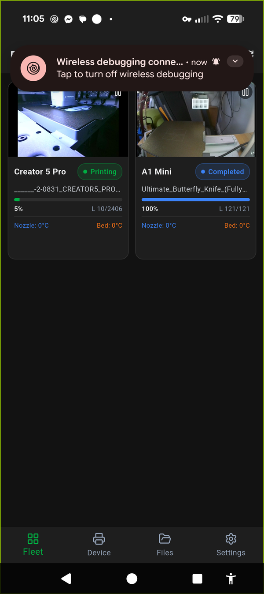
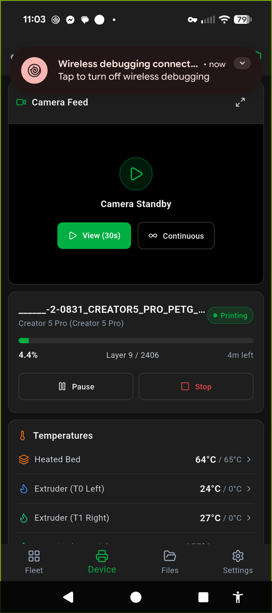
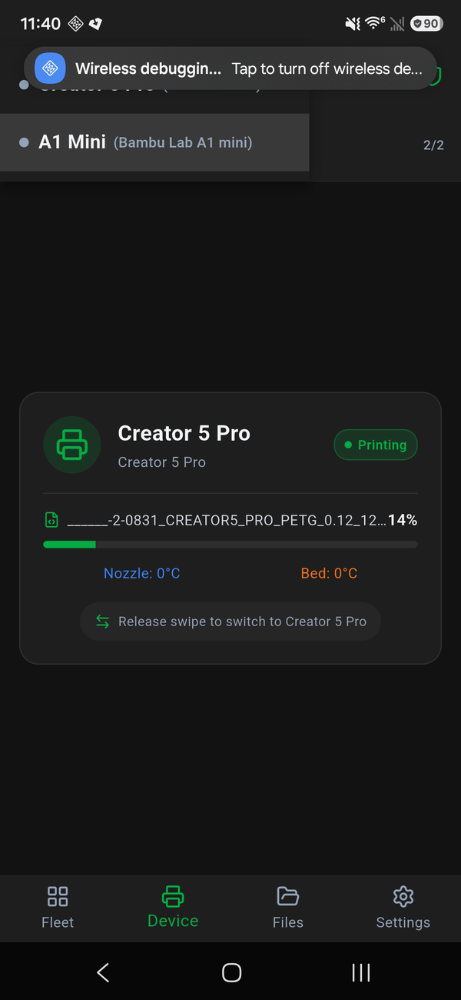
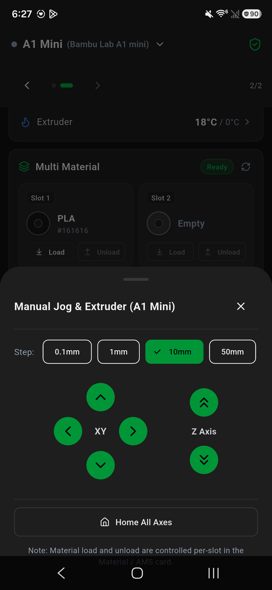
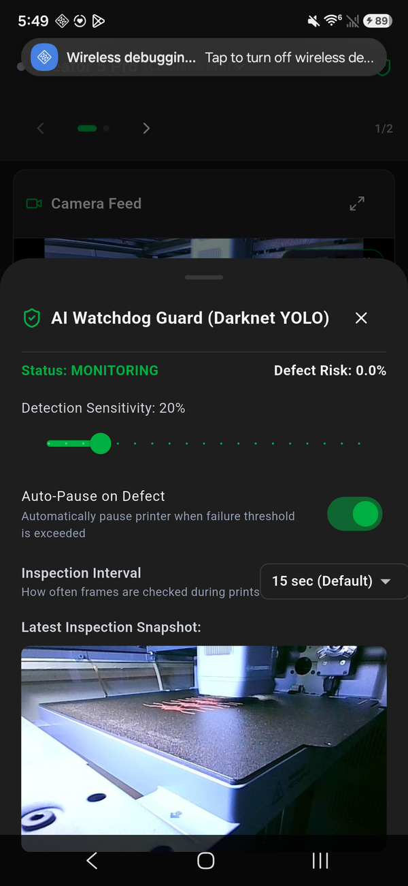

<div align="center">


# YourPrinter

**A self-hosted management dashboard and mobile app for FlashForge and Bambu Lab 3D printers.**

[](LICENSE)
[](#supported-printers)
[](https://github.com/christianborges121/YourPrinter/releases)

<br />

<p align="center">
  
  &nbsp;&nbsp;
  
</p>

</div>

---

YourPrinter connects directly to your 3D printers over your local network — no cloud accounts, no subscriptions, and no vendor lock-in. Monitor multiple printers simultaneously, stream low-latency camera feeds, manage multi-material systems, and detect print failures using an onboard local AI watchdog.

---

## Key Features

### 🖥️ Multi-Printer Fleet Dashboard
Monitor your entire print farm from a single screen. Track live progress, remaining print time, layer heights, and temperatures across all connected machines in real time.
- Direct printer status cards with active job tracking
- Seamless switching between individual device dashboards

### 📹 Low-Latency Live Camera Streaming
Powered by an embedded [go2rtc](https://github.com/AlexxIT/go2rtc) streaming gateway.
- Sub-second WebRTC and MJPEG streams directly from printer cameras
- Multi-camera fleet view with simultaneous live video
- Automatic snapshot fallback for slower or intermittent network connections

### 🎨 Multi-Material & Multi-Toolhead Controls
<p align="center">
  
  &nbsp;&nbsp;
  
</p>

First-class support for multi-color and multi-extruder hardware:
- **Bambu Lab AMS Lite**: 4-slot filament status, active slot selection, and material tracking.
- **FlashForge Creator 5 / 5 Pro**: Independent multi-head toolhead monitoring (Heads 1–4) with per-nozzle temperatures and IFS filament slots.
- **Manual Control**: Interactive motion jog pad, custom extrusion lengths, part cooling fan sliders, and chamber lighting toggles.

### 🧠 On-Prem AI Print Failure Watchdog
<p align="center">
  
</p>

Catch spaghetti and print failures before wasting hours of print time and filament:
- Integrated Obico (YOLO/Darknet) visual failure detection running 100% locally on your GPU
- Automatic print pausing when failure confidence exceeds your custom threshold
- Push notifications and Discord webhook alerts with captured failure frames

### 📱 Native Mobile Companion
A Flutter-based Android and iOS mobile app with full feature parity:
- Low-latency camera feeds and fleet monitoring on the go
- Local notifications when prints finish or failures are detected
- Direct APK downloads available under [Releases](https://github.com/christianborges121/YourPrinter/releases)

---

## Supported Printers

| Printer | Connection | Multi-Material / Toolheads | Camera |
| :--- | :--- | :--- | :--- |
| **FlashForge Creator 5 / 5 Pro** | TCP / HTTP API | 4 Independent Toolheads (IFS) | Native MJPEG |
| **FlashForge AD5X** | TCP / HTTP API | 4-Slot Multi-Material (IFS) | Native RTSP / WebRTC |
| **Bambu Lab A1 mini** | LAN Mode (MQTT + FTPS) | AMS Lite (4 Slots) | Port 6000 / WebRTC |
| **FlashForge Adventurer 5M Pro** | TCP / HTTP API | Single Extruder + Air Filtration | Native RTSP / WebRTC |
| **FlashForge Adventurer 5M** | TCP / HTTP API | Single Extruder | Native RTSP / WebRTC |
| **FlashForge Adventurer 3 / 4** | Legacy FlashForge Protocol | Single Extruder | Native MJPEG / Snapshot |

---

## Quick Start

### Option 1: Docker Compose (Recommended)

The easiest way to run the backend server, WebUI, and AI watchdog:

```bash
# Clone the repository
git clone https://github.com/christianborges121/YourPrinter.git
cd YourPrinter

# Optional: configure Discord webhooks or alert thresholds
cp watchdog/.env.example .env

# Start the stack
docker compose up -d
```

Open your browser to `http://localhost:3080` (or your host IP).

| Container | Port | Service |
| :--- | :--- | :--- |
| `yourprinter-web` | `3080` | WebUI Dashboard |
| `yourprinter` | `3000` | Backend API & go2rtc Camera Proxy |
| `watchdog` | `8085` | GPU AI Failure Detection Engine |

---

### Option 2: Desktop App (Electron)

If you prefer a native desktop application on Windows, Linux, or macOS:

```bash
cd desktop
pnpm install
pnpm build
pnpm start
```

---

### Option 3: Android Mobile App

Download the latest pre-compiled APK from the [Releases](https://github.com/christianborges121/YourPrinter/releases) page and point it to your YourPrinter server IP address.

To build from source:

```bash
cd mobile
flutter pub get
flutter build apk --release
```

---

## Monorepo Structure

```text
YourPrinter/
├── desktop/    # Electron app, headless backend server, printer backends & go2rtc gateway
├── web/        # Browser WebUI dashboard
├── mobile/     # Flutter mobile companion app (Android & iOS)
├── watchdog/   # Local GPU AI failure detection engine (Obico / YOLO)
└── shared/     # Shared protocol types, API schemas, and assets
```

---

## Upstream Credits & Attribution

YourPrinter builds upon and unifies several open-source community projects:

- **[Parallel-7/FlashForgeUI-Electron](https://github.com/Parallel-7/FlashForgeUI-Electron)** by **GhostTypes** — Original desktop & WebUI architecture, multi-printer context system, go2rtc integration, and FlashForge client protocols.
- **[rolohaun/FlashForgeUI-Electron-Creator5](https://github.com/rolohaun/FlashForgeUI-Electron-Creator5)** by **rolohaun** — FlashForge Creator 5 multi-extruder compatibility and IFS protocol support.
- **YourPrinter** by **christianborges121** — Monorepo unification, Bambu Lab LAN-mode integration (MQTT/FTPS/AMS Lite), local GPU AI failure watchdog, and native Flutter mobile application.

All original licenses and copyright notices are preserved in [`LICENSE`](LICENSE).

---

## License

This project is licensed under the [MIT License](LICENSE).
